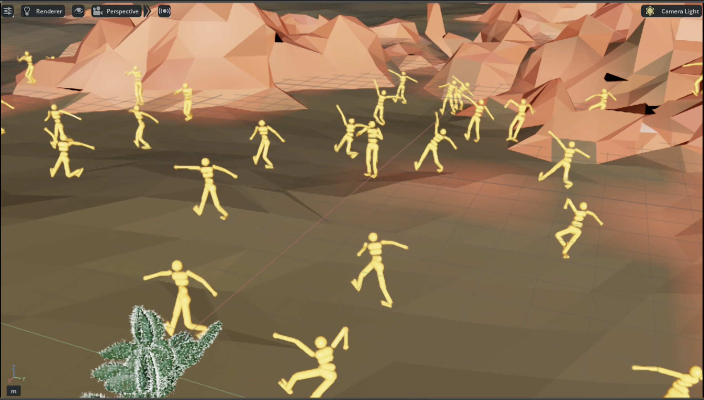
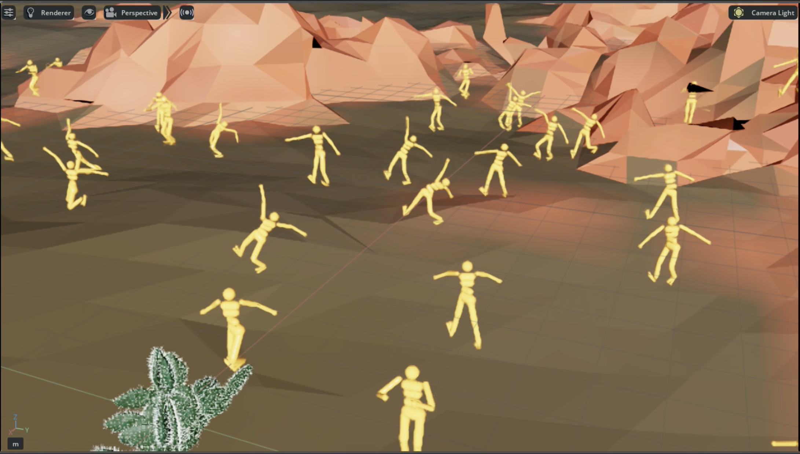

# Memory-Perceiver

Memory-Perceiver explores transformer-based recurrent architectures for humanoid locomotion from multi-modal observations, combining proprioceptive state and video inputs, in proceduarlly generated worlds.

In particular, the project investigates whether a Perceiver-style latent architecture can support control in a partially observable environment (goal is to find and walk to object X); and how memory mechanisms and distillation can improve training stability and sample efficiency.

## Perceiver

The core policy architecture is based on <a href="https://arxiv.org/abs/2107.14795">Perceiver IO</a>, a transformer designed for flexible multi-modal inputs and outputs.

</img>

In this project, the Perceiver is adapted to control tasks with:
- body or joint position inputs
- visual observations
- a recurrent memory latent carried across timesteps

The memory latent plays a role similar to an RNN hidden state, allowing the policy to retain information over long horizons and better handle partial observability.

## Reinforcement Learning

The architecture is trained in Isaac Lab for humanoid locomotion in procedurally generated environments created with <a href="https://github.com/princeton-vl/infinigen">Infinigen</a>.

### Training setup

I implemented a distributed version of Proximal Policy Optimization (PPO) for this setting.

Because transformer-based policies are expensive to optimize directly in RL, training is bootstrapped through a distillation stage:
1. a simpler fully connected policy is trained first,
2. the Perceiver policy is distilled from this teacher,
3. the distillation loss is gradually annealed,
4. training continues with PPO alone.

This teacher-student schedule improves optimization speed and stabilizes early training.

30k steps:  
</img>  
https://media3.giphy.com/media/v1.Y2lkPTc5MGI3NjExcW16cDM4NHhwZDZua2c3Z3hzNWRiYmp5bnliNXd0bWdtNjBkcmJueiZlcD12MV9pbnRlcm5hbF9naWZfYnlfaWQmY3Q9Zw/oX5xrycEOeJrxnh9W4/giphy.gif

100k steps:  
</img>  
https://media0.giphy.com/media/v1.Y2lkPTc5MGI3NjExcjYwZTE0aDl2NmlnMGU3ZHJ2eGo4YjJrcjJyaDQxeDg0ZnQ2NGN3MCZlcD12MV9pbnRlcm5hbF9naWZfYnlfaWQmY3Q9Zw/cdQf6kaR1QwBjURmjU/giphy.gif

## Behavior Cloning for pre-training

In addition to reinforcement learning, the project explored behavior cloning as a pre-training strategy to:
- improve convergence on difficult RL tasks
- encourage more natural human-like motion

The model was trained autoregressively to predict human body pose from video and past body positions. Then the backbone was reused in the RL setting. It improved convergence time with a better initialization, but training was still needed since the output was different. An algorithm to adapt the output from SMPL-X to the humanoid joints would have been ideal.


https://giphy.com/gifs/mySDfU3cx4mPTEJ6ka

### Recurrence experiments

As an alternative to standard backpropagation-based recurrence, I experimented with Real-Time Recurrent Learning (RTRL) against classic back-propagation through time (BPTT) on toy memory tasks. RTRL stores and updates the jacobian of the gradient online, thus it doesn't need to backpropagate through time. This method has a high computational cost, only tractable for a small model (~10k parameters). Although RTRL seems promising because it is independent to sequence length, I've found the algorithm too unstable even on simple "needle in a haystack" tasks. This is not clearly mentioned in the few existing papers about RTRL. The reason for instability is the recursive jacobian update, which is fundamentally unstable for long-sequence unless the model do updates close to the identity, which are not usefull.

## Citation

```bibtex
@misc{jaegle2021perceiver,
    title   = {Perceiver: General Perception with Iterative Attention},
    author  = {Andrew Jaegle and Felix Gimeno and Andrew Brock and Andrew Zisserman and Oriol Vinyals and Joao Carreira},
    year    = {2021},
    eprint  = {2103.03206},
    archivePrefix = {arXiv},
    primaryClass = {cs.CV}
}
