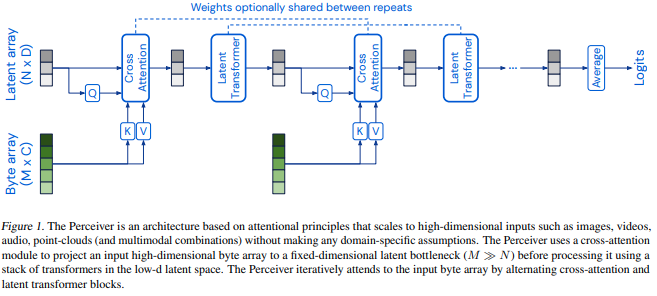

# Memory-Perceiver

Memory-Perceiver is an attempt to model human behavior using multi-sensorial data. The goal of this auto-regressive model is to predict body position and speech for a human subject using video, sound and body position inputs.

Additionaly a compressed memory latent inspired from RNN allows to better predict very long sequences.

## Perceiver

The backbone model is  perceiverIO <a href="https://arxiv.org/abs/2107.14795">Perceiver IO</a>, a transformer structure adapted to multi-modal inputs and outputs:

</img>


```python
import torch
from perceiver_pytorch import PerceiverIO

model = PerceiverIO(
    dim = 32,                    # dimension of sequence to be encoded
    queries_dim = 32,            # dimension of decoder queries
    logits_dim = 100,            # dimension of final logits
    depth = 6,                   # depth of net
    num_latents = 256,           # number of latents, or induced set points, or centroids. different papers giving it different names
    latent_dim = 512,            # latent dimension
    cross_heads = 1,             # number of heads for cross attention. paper said 1
    latent_heads = 8,            # number of heads for latent self attention, 8
    cross_dim_head = 64,         # number of dimensions per cross attention head
    latent_dim_head = 64,        # number of dimensions per latent self attention head
    weight_tie_layers = False    # whether to weight tie layers (optional, as indicated in the diagram)
)
```
## Dataset

The dataset is extracted using videos of social or physical interactions. The body position is retrieved with a model predicting SMPL-X (https://smpl-x.is.tue.mpg.de) parameters from images. The body positions are then smoothed on the temporal dimension.

## Training

Distributed training is performed with pytorch on google cloud with 8 TPU cores.

## Prelimenary result

Using a sufficiently long input sequence, the model is able to imitate human behavior:


ezgif.com-video-to-gif.gif


## Citations

```bibtex
@misc{jaegle2021perceiver,
    title   = {Perceiver: General Perception with Iterative Attention},
    author  = {Andrew Jaegle and Felix Gimeno and Andrew Brock and Andrew Zisserman and Oriol Vinyals and Joao Carreira},
    year    = {2021},
    eprint  = {2103.03206},
    archivePrefix = {arXiv},
    primaryClass = {cs.CV}
}
```

